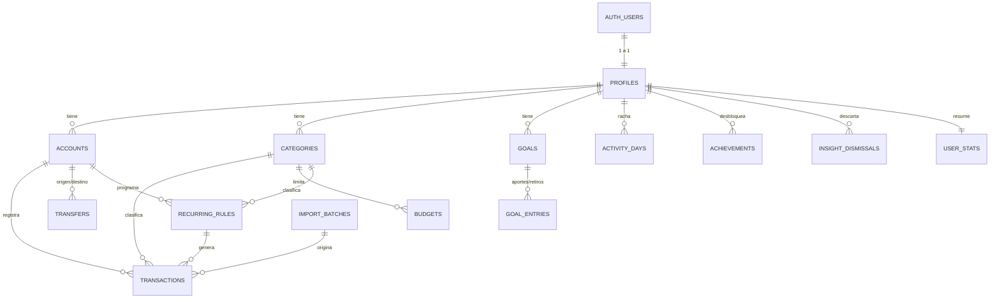

# 04 · Modelo de Datos — Zavia

> Estado: BORRADOR v0.6 · Base de datos: PostgreSQL en Supabase.
> Principio rector: **la base de datos garantiza integridad y aislamiento; las fórmulas de negocio viven en código TypeScript puro** (RNF-051). Por eso no hay cálculos de proyección, semáforos ni insights dentro de la base.

## 1. Convenciones

| Tema | Convención |
|------|-----------|
| Idioma de nombres | Tablas y columnas en **inglés** y `snake_case`; la interfaz es bilingüe (RF-038) |
| Claves | `uuid` con `gen_random_uuid()` |
| Dueño | Toda tabla con datos de usuario tiene `user_id uuid not null references auth.users(id) on delete cascade` (así la eliminación de cuenta borra todo, RNF-065) |
| Dinero | `bigint` en **unidad menor** (columnas `*_minor`) + `currency` (`'PEN'` o `'USD'`). Nunca `float`/`numeric` para montos (RN-001, RNF-013). El tipo de cambio es la única excepción: `numeric(10,4)` |
| Fechas | `occurred_on date` (día en `America/Lima`, RN-070); instantes en `timestamptz` (UTC) |
| Auditoría | `created_at timestamptz not null default now()`; `updated_at` con disparador donde se edita |
| Eliminación lógica | `deleted_at timestamptz null` en transacciones, transferencias y metas (RN-006) |
| Archivado | `archived_at timestamptz null` en cuentas y categorías (RN-010, RN-013) |
| Migraciones | Una migración versionada por cambio; la base se recrea desde cero (RNF-017) |

## 2. Diagrama entidad-relación



`DEMO_SIGNUPS` (control de abuso) no pertenece a ningún usuario y se omite del diagrama.

## 3. Tipos enumerados

| Enum | Valores |
|------|---------|
| `account_type` | `cash`, `bank`, `card`, `wallet` |
| `category_kind` | `income`, `expense` |
| `tx_kind` | `income`, `expense` |
| `tx_source` | `manual`, `recurring`, `import`, `seed` |
| `goal_status` | `active`, `paused`, `completed` (el estado *vencida* se **deriva**, RN-024) |
| `goal_entry_kind` | `contribution`, `withdrawal` |
| `recurring_frequency` | `weekly`, `monthly`, `yearly` |
| `recurring_status` | `active`, `paused`, `cancelled` |
| `activity_kind` | `transaction`, `no_spend` |

## 4. Tablas

### 4.1 `profiles` — 1 a 1 con `auth.users`
| Columna | Tipo | Reglas |
|---------|------|--------|
| `id` | uuid PK | = `auth.users.id`, `on delete cascade` |
| `first_name`, `last_name` | text | 1–40 caracteres. En **cuentas reales** vienen de Google y se sanean igual que cualquier texto (SEG-INP-03, SEG-AUT-12); en el **demo** vienen del formulario (RN-060) |
| `locale` | text | `'es'` o `'en'`, por defecto `'es'` (RF-038) |
| `base_currency` | char(3) | `'PEN'` por defecto |
| `usd_pen_rate` | numeric(10,4) | > 0 (RN-027) |
| `date_format` | text | preferencia de formato (RF-024) |
| `show_achievements` | boolean | por defecto `true` (RF-037) |
| `onboarding_done` | boolean | por defecto `false` (RF-041) |
| `is_demo` | boolean | por defecto `false` |
| `demo_expires_at` | timestamptz null | `created_at + 24 h` si `is_demo` (RNF-027) |
| `created_at` | timestamptz | |

Check: `is_demo = (demo_expires_at is not null)`.

### 4.2 `accounts`
| Columna | Tipo | Reglas |
|---------|------|--------|
| `id`, `user_id` | uuid | |
| `name` | text | 1–40 caracteres |
| `type` | `account_type` | |
| `currency` | char(3) | `'PEN'`/`'USD'`; **inmutable** si hay transacciones (RN-010), reforzado por disparador |
| `opening_balance_minor` | bigint | puede ser negativo (tarjetas) |
| `archived_at` | timestamptz null | solo con saldo 0 (RN-010, se valida en la capa de aplicación y por RPC) |
| `created_at` | timestamptz | |

Restricciones únicas auxiliares: `unique (id, user_id)` y `unique (id, currency)` (se usan en las claves foráneas compuestas de abajo).

### 4.3 `categories`
| Columna | Tipo | Reglas |
|---------|------|--------|
| `id`, `user_id` | uuid | |
| `kind` | `category_kind` | RN-013 |
| `default_key` | text null | clave de las predeterminadas (p. ej. `food`, `salary`); se traduce al mostrar (RN-071) |
| `name` | text null | nombre propio; **check:** `name is not null or default_key is not null` |
| `archived_at` | timestamptz null | |

Único: `(user_id, kind, lower(coalesce(name, default_key)))`. Único auxiliar: `(id, user_id)`.
Las predeterminadas se crean al registrarse o al crear la sesión demo.

### 4.4 `transactions` (solo ingresos y gastos)
| Columna | Tipo | Reglas |
|---------|------|--------|
| `id`, `user_id` | uuid | |
| `account_id` | uuid | FK compuesta `(account_id, user_id)` → `accounts(id, user_id)` |
| `currency` | char(3) | FK compuesta `(account_id, currency)` → `accounts(id, currency)`: **la moneda siempre es la de la cuenta** |
| `category_id` | uuid | FK compuesta `(category_id, user_id)` → `categories(id, user_id)`; el `kind` de la categoría debe coincidir con el de la transacción (disparador) (RN-013) |
| `kind` | `tx_kind` | |
| `amount_minor` | bigint | `> 0` y `≤ 99999999999` (RN-005) |
| `occurred_on` | date | entre hoy − 10 años y hoy + 31 días (RN-004), validado en servidor y con `check` amplio |
| `description` | text null | ≤ 140 (RN-005) |
| `source` | `tx_source` | `manual` por defecto |
| `recurring_id` | uuid null | FK a `recurring_rules` |
| `recurring_occurrence_on` | date null | |
| `import_batch_id` | uuid null | FK a `import_batches` |
| `client_request_id` | uuid null | Identificador generado por el cliente para que un doble clic o un reintento **no duplique** el registro; único por usuario (ver abajo) |
| `created_at` | timestamptz | se usa para la racha (RN-051) |
| `deleted_at` | timestamptz null | RN-006 |

Restricciones clave:
- **Idempotencia de recurrentes (RN-030, RNF-010):** índice único parcial `unique (recurring_id, recurring_occurrence_on) where recurring_id is not null`.
- `check ((source = 'recurring') = (recurring_id is not null))`.
- **Idempotencia de creación (contrato de API):** índice único parcial `unique (user_id, client_request_id) where client_request_id is not null`.

### 4.5 `transfers` (un solo registro por transferencia, RN-007)
| Columna | Tipo | Reglas |
|---------|------|--------|
| `id`, `user_id` | uuid | |
| `from_account_id`, `to_account_id` | uuid | FKs compuestas con `user_id`; `check (from_account_id <> to_account_id)` |
| `amount_out_minor` | bigint | `> 0`, en la moneda de la cuenta de origen |
| `amount_in_minor` | bigint | `> 0`, en la moneda de la cuenta de destino; si ambas monedas son iguales, debe ser igual a `amount_out_minor` (disparador) |
| `occurred_on` | date | |
| `description` | text null | |
| `client_request_id` | uuid null | Igual que en `transactions`; único por usuario cuando no es nulo |
| `created_at`, `deleted_at` | timestamptz | |

### 4.6 `budgets` (versiones por mes, RN-025)
| Columna | Tipo | Reglas |
|---------|------|--------|
| `id`, `user_id` | uuid | |
| `category_id` | uuid | FK compuesta con `user_id`; solo categorías de gasto |
| `effective_from` | date | primer día de un mes |
| `limit_minor` | bigint null | `> 0` en moneda base; **`null` = sin presupuesto desde ese mes** (así se retira un presupuesto sin borrar su historial) |
| `created_at` | timestamptz | |

Único: `(user_id, category_id, effective_from)`. **Límite vigente de un mes M** = fila con la mayor `effective_from ≤ M` de esa categoría. Así los meses pasados conservan su límite histórico. Si la versión vigente tiene `limit_minor = null`, no hay presupuesto ese mes. Un presupuesto también deja de aplicar si su categoría está archivada (RN-013).

### 4.7 `goals`
| Columna | Tipo | Reglas |
|---------|------|--------|
| `id`, `user_id` | uuid | |
| `name` | text | 1–40 |
| `currency` | char(3) | inmutable con aportes (RN-023) |
| `target_minor` | bigint | `> 0` |
| `initial_saved_minor` | bigint | `≥ 0`, por defecto 0 (RF-014) |
| `deadline` | date | futura al crear (RF-014) |
| `status` | `goal_status` | RN-024 |
| `completed_at` | timestamptz null | |
| `created_at`, `deleted_at` | timestamptz | |

Valor **derivado** (no almacenado): `saved = initial_saved_minor + Σ aportes − Σ retiros`.

### 4.8 `goal_entries`
| Columna | Tipo | Reglas |
|---------|------|--------|
| `id`, `user_id` | uuid | |
| `goal_id` | uuid | FK compuesta con `user_id` |
| `kind` | `goal_entry_kind` | |
| `amount_minor` | bigint | `> 0`; un retiro no puede dejar `saved < 0` (validado en la operación atómica, RN-022) |
| `occurred_on` | date | no futura |
| `client_request_id` | uuid null | Idempotencia, único por usuario cuando no es nulo |
| `created_at` | timestamptz | |

Los aportes **no** tocan `accounts` ni `transactions` (RN-022).

### 4.9 `recurring_rules`
| Columna | Tipo | Reglas |
|---------|------|--------|
| `id`, `user_id` | uuid | |
| `account_id`, `category_id` | uuid | FKs compuestas; moneda tomada de la cuenta |
| `kind` | `tx_kind` | |
| `amount_minor` | bigint | `> 0` |
| `frequency` | `recurring_frequency` | |
| `start_on` | date | ancla del día de cobro |
| `end_on` | date null | |
| `status` | `recurring_status` | |
| `is_subscription` | boolean | por defecto `false` |
| `service_name` | text null | solo si `is_subscription` |
| `description` | text null | |
| `resume_from` | date null | al reanudar tras una pausa: ocurrencias anteriores no se generan retroactivamente (RN-030) |
| `created_at` | timestamptz | |

La **n-ésima ocurrencia** se calcula **siempre desde `start_on`** (no sumando sobre la anterior) y con la regla del último día del mes. Así el día 31 no "deriva" a 28 para siempre (RN-030). La función es de dominio y vive en TypeScript.

### 4.10 `import_batches`
| Columna | Tipo | Reglas |
|---------|------|--------|
| `id`, `user_id` | uuid | |
| `filename` | text | ≤ 120 |
| `rows_total`, `rows_imported`, `rows_skipped` | integer | |
| `created_at` | timestamptz | |

### 4.11 `activity_days` (racha, RN-051)
| Columna | Tipo | Reglas |
|---------|------|--------|
| `user_id` | uuid | |
| `day` | date | día de **registro** en `America/Lima` |
| `kind` | `activity_kind` | |

PK `(user_id, day)`. Se inserta (con `on conflict do nothing`) al crear una transacción `manual` y al marcar "Hoy no gasté". No se insertan por importaciones, recurrentes, transferencias ni datos `seed` (RN-052).

### 4.12 `achievements`
`user_id`, `key` (text, restringido al catálogo de RN-050), `unlocked_at`. PK `(user_id, key)`: un logro se desbloquea **una sola vez**.

### 4.13 `insight_dismissals`
`user_id`, `dedupe_key` (RN-040), `severity_at_dismissal` (`info`/`attention`/`alert`), `period_end` (date), `dismissed_at`. PK `(user_id, dedupe_key)`.
Los insights **no se almacenan**: se calculan al consultar con funciones puras; solo se guardan los descartes.

### 4.14 `user_stats`
`user_id` PK, `best_streak_days integer default 0`, `updated_at`. La racha actual se deriva de `activity_days`.

### 4.15 `demo_signups` (control de abuso, RNF-028)
`id`, `ip_hash` (text, hash con secreto del servidor; **no se guarda la IP**), `created_at`. Se purga a las 24 h. Sin acceso desde el cliente (ninguna política RLS; solo el servidor con rol de servicio).

## 5. Índices## 5. Índices

| Tabla | Índice | Para |
|-------|--------|------|
| `transactions` | `(user_id, occurred_on desc) where deleted_at is null` | Lista paginada (RF-009), dashboard |
| `transactions` | `(user_id, category_id, occurred_on)` | Presupuestos e insights |
| `transactions` | `(account_id, occurred_on)` | Saldo por cuenta |
| `transactions` | GIN `description gin_trgm_ops` (extensión `pg_trgm`) | Búsqueda de texto (RF-009) |
| `transfers` | `(user_id, occurred_on desc)`, `(from_account_id)`, `(to_account_id)` | Listados y saldos |
| `goal_entries` | `(goal_id, occurred_on)` | Ritmo de la meta (RN-020) |
| `recurring_rules` | `(user_id, status)` | Generación diaria |
| `profiles` | `(demo_expires_at) where is_demo` | Limpieza de demos |
| `demo_signups` | `(ip_hash, created_at)` | Límite por IP |
| `transactions`, `transfers`, `goal_entries` | único parcial `(user_id, client_request_id)` | Idempotencia de creación |

Los índices se validan con `EXPLAIN` en pruebas de integración (RNF-007).

## 6. Vistas y funciones de lectura

Todas las vistas se crean con **`security_invoker = true`** para que las políticas RLS del usuario que consulta sigan aplicándose.

| Objeto | Propósito |
|--------|-----------|
| Vista `account_balances` | Saldo actual y proyectado por cuenta (RN-002) |
| Vista `ledger` | Une `transactions` y `transfers` para el listado de movimientos (RF-009) |
| Función `monthly_totals(month)` | Ingresos y gastos por mes y categoría, sin transferencias (RF-020 a RF-022) |
| Función `create_transfer(...)` | Valida cuentas, monedas e idempotencia y crea la transferencia en una sola operación (RN-007) |
| Función `add_goal_entry(...)` | Inserta un aporte o retiro, impide `saved < 0` y marca la meta como completada si corresponde (RN-022, RN-024), todo atómico |
| Función `archive_account(id)` | Comprueba saldo 0 y archiva (RN-010) |
| Función `confirm_import(...)` | Inserta un lote de filas validadas y registra `import_batches` en una transacción (RN-012, RN-014) |
| Función `database_size_bytes()` | Devuelve el tamaño de la base para el **freno por tamaño** (RNF-071). Ejecutable **solo por el rol de servicio** |

Las funciones se declaran **`security invoker`**: se ejecutan con los permisos del usuario, de modo que RLS sigue aplicando.

El cálculo en moneda base con tipo de cambio (RN-027) se hace en TypeScript sobre estos totales, no en SQL.

## 7. Seguridad a nivel de datos (resumen; detalle en `09-seguridad.md`)

- **RLS activo en el 100 % de las tablas** con datos de usuario (RNF-020). Patrón único:

```sql
alter table public.accounts enable row level security;

create policy "own rows" on public.accounts
  for all
  using      (user_id = (select auth.uid()))
  with check (user_id = (select auth.uid()));
```

- Las **claves foráneas compuestas** `(entidad_id, user_id)` hacen imposible, incluso con un error de código, vincular una transacción de un usuario con una cuenta o categoría de otro (RN-008).
- **Visitantes demo** son usuarios anónimos de Supabase: usan exactamente las mismas políticas, por lo que quedan aislados entre sí (RNF-019).
- El **rol de servicio** (clave secreta) solo se usa en el servidor para: sembrar datos del demo, limpiar sesiones caducadas, purgar eliminados y escribir `demo_signups`. Nunca llega al navegador (RNF-025).
- Una prueba automática recorre el catálogo de la base y **falla si alguna tabla del esquema público no tiene RLS** (RNF-020).

### 7.1 Permisos del cliente por tabla y columna
El navegador puede hablar con la API de Supabase con su propia sesión, así que los permisos se definen **en la base** (tabla completa en `09-seguridad.md`, sección 4.2). Resumen:
- Rol `anon`: **sin acceso** a ninguna tabla de usuario. Las sesiones demo usan el rol `authenticated`.
- `profiles`: el cliente solo actualiza columnas de preferencias; `is_demo` y `demo_expires_at` son de solo servidor.
- `achievements`, `user_stats`, `activity_days`: lectura propia; **sin escritura del cliente** (las escribe el servidor con el rol de servicio).
- `demo_signups`: sin política alguna; solo rol de servicio.
- `transactions.source`: una política de inserción impide que el cliente use valores reservados (`recurring`, `seed`, `import`) fuera de las funciones previstas.

### 7.2 Disparadores e invariantes (se imponen aunque el cliente la salte)
Fecha del movimiento entre hoy − 10 años y hoy + 31 días (RN-004) · tipo de categoría igual al del movimiento (RN-013) · moneda inmutable con movimientos (RN-010, RN-023) · un retiro de meta no deja el ahorrado por debajo de 0 (RN-022) · coherencia de montos de transferencias (RN-007) · longitudes máximas (RN-005). Detalle y pruebas en `09-seguridad.md`, sección 5.

### 7.3 Cuotas por usuario
Disparadores de conteo (RN-009, RNF-067): usuario real hasta **5,000** movimientos; **sesión demo hasta 1,000**; 100 cuentas, 200 metas y 50 recurrentes (valores iniciales ajustables). Al superarlos, la base rechaza la inserción y la aplicación devuelve `QUOTA_EXCEEDED`.

### 7.4 Funciones SQL
Todas con `search_path` fijo y permiso de ejecución solo para `authenticated` (se revoca a `public`).

## 8. Procesos programados

| Proceso | Frecuencia | Regla / RNF |
|---------|-----------|-------------|
| Generar ocurrencias recurrentes | Diario, más al iniciar sesión (recuperación) | RN-030, RNF-010 |
| Purgar eliminados de más de 30 días | Diario | RN-006, RNF-016 |
| Eliminar demos caducados y usuarios anónimos huérfanos (sin perfil tras 1 h); todo lo suyo se borra por cascada | Cada hora | RNF-027 |
| Purgar `demo_signups` de más de 24 h | Cada hora | RNF-028 |
| Actividad "keep-alive" de la base | Diario | RNF-009 |

El mecanismo (pg_cron o tareas programadas del hosting) se decide en `05-arquitectura-y-stack.md`.

## 9. Datos semilla

- **Categorías predeterminadas** (claves): ingresos → `salary`, `other_income`; gastos → `food`, `transport`, `housing`, `health`, `education`, `leisure`, `utilities`, `other_expense`.
- **Datos del demo:** se generan por código con fechas relativas a hoy, usando las funciones de dominio, según RN-061, con `source = 'seed'` (RN-052).

## 10. Decisiones de diseño y su motivo

| Decisión | Motivo |
|----------|--------|
| `transfers` separada de `transactions` | Una transferencia es un solo hecho; con una tabla aparte no puede quedar a medias y nunca se cuela en ingresos/gastos (RN-007) |
| Presupuestos versionados por mes | Cumple "meses pasados conservan su límite" sin duplicar filas cada mes |
| Insights calculados, no almacenados | Evita datos desactualizados; solo se persiste lo que el usuario decide (descartar) |
| Claves foráneas compuestas con `user_id` | Segunda barrera de aislamiento además de RLS |
| Ocurrencias calculadas desde `start_on` | Evita el desvío del día 31 y facilita probar la regla |
| No se guarda la IP, solo su hash | Minimización de datos (RNF-064) |
| Aportes de metas fuera de `transactions` | Decisión del autor: son una reserva virtual (RN-022) |
