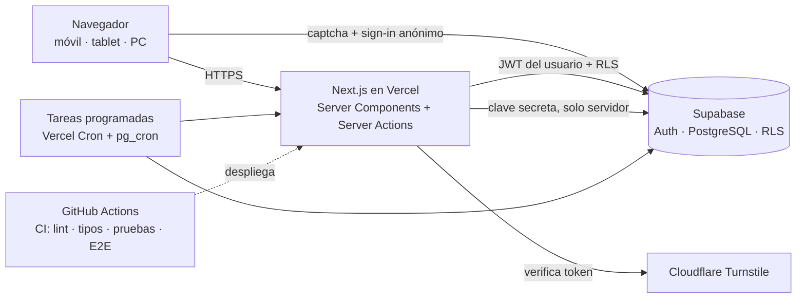
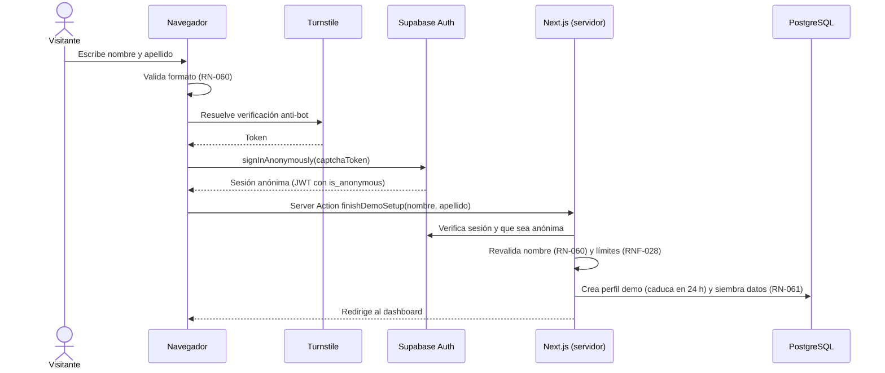

# 05 · Arquitectura y Stack — Zavia

> Estado: BORRADOR v0.4 · Las versiones exactas **no se fijan aquí**: al iniciar el proyecto, el agente instala la última versión estable de cada paquete, la fija en `package.json` y registra en el README cualquier diferencia con este documento.
> Puntos que el agente **debe verificar en la documentación vigente** antes de implementar están marcados con 🔎.

## 1. Vista general



**Idea central:** Next.js es el único backend (no hay servidor Express aparte). El navegador nunca recibe claves secretas; toda mutación pasa por el servidor, que valida, autentica y delega la autorización a la base de datos (RLS).

## 2. Stack y decisiones

| Área | Elección | Motivo | Alternativa descartada |
|------|----------|--------|------------------------|
| Framework | **Next.js (App Router) + React + TypeScript `strict`** | Decisión del autor; Server Components reducen JS en móvil (RNF-006) | Vite + Express (dos proyectos que mantener) |
| Estilos | **Tailwind CSS** + tokens de diseño (documento 07) | Decisión del autor; responsive mobile-first | CSS Modules |
| Componentes | **shadcn/ui** (Radix UI) | Accesibles por defecto (RNF-033, RNF-035); el código queda en el repo | MUI (más pesado y menos personalizable) |
| Base de datos y auth | **Supabase** (PostgreSQL, Auth, RLS) | Decisión del autor; RLS + sesiones anónimas para el demo | Firebase (sin SQL relacional) |
| Cliente de datos | **`@supabase/ssr` + `supabase-js`** con tipos generados desde el esquema | Las consultas usan el JWT del usuario, así RLS siempre aplica (RNF-019) | Prisma/Drizzle (saltan RLS si usan una conexión directa) |
| Validación | **Zod**, un esquema compartido entre cliente y servidor | RNF-015 | Validaciones duplicadas a mano |
| Formularios | **React Hook Form** + resolver de Zod | Formularios rápidos y accesibles en móvil | Estado manual |
| Mutaciones y UI optimista | **Server Actions** + `useOptimistic` de React | Sin librería extra; cubre "Deshacer" y respuesta inmediata (RF-040) | TanStack Query (se reconsidera solo si hace falta) |
| Gráficos | **Recharts** + tabla alternativa accesible | Sencillo, interactivo (RF-021); la tabla cubre lo que el gráfico no | Chart.js (menos integrado con React) |
| i18n | **next-intl** | Soporte nativo de App Router (RF-038) | react-i18next |
| Fechas | **date-fns** con soporte de zonas horarias (`America/Lima`) 🔎 | RN-070 | Moment (obsoleto) |
| Dinero | Módulo propio `Money` sobre enteros (RN-001) | Control total del redondeo *half-up* (RN-003) | Librerías con decimales flotantes |
| Anti-bot | **Cloudflare Turnstile** | Gratuito; recomendado por Supabase para sesiones anónimas (RNF-029) | reCAPTCHA |
| Pruebas | **Vitest**, Testing Library, **Playwright**, `@axe-core/playwright`, Lighthouse CI | Detalle en documento 10 | Jest + Cypress |
| Calidad | ESLint, Prettier, `commitlint`, Husky + lint-staged, regla de complejidad ≤ 10 | RNF-048 a RNF-053 | — |
| Gestor de paquetes | **pnpm** | Rápido y reproducible | npm (también válido) |
| Hosting | **Vercel Hobby** (frontend + servidor) y **Supabase Free** (datos) | Costo cero y sin tarjeta (RNF-060, RNF-070); **sin dominio propio**: la URL es `*.vercel.app`. Vercel Hobby es solo para uso personal no comercial (un portafolio lo es) | Render/Railway |
| CI/CD | **GitHub Actions** | RNF-056 | — |

## 3. Capas y regla de dependencias

```
domain  ←  application  ←  infrastructure
                ↑                 ↑
                └──────  app (Next.js: rutas, componentes, acciones)
```

| Capa | Contiene | Puede importar | **No puede** importar |
|------|----------|----------------|------------------------|
| `domain` | Funciones puras: dinero, saldos, proyección de metas, semáforos, presupuestos, recurrentes, insights, logros, generador de datos demo, esquemas Zod | Solo TypeScript y librerías de utilidades puras | `next`, `react`, `supabase`, `fetch`, `Date.now()` directo (el reloj se inyecta) |
| `application` | Casos de uso (`createTransaction`, `startDemo`, `contributeToGoal`…): orquestan dominio + repositorios y devuelven `Result` tipado | `domain` y **interfaces** de repositorios | Next.js, Supabase concreto |
| `infrastructure` | Repositorios sobre Supabase, cliente Turnstile, hash de IP, logger | `domain`, `application` | Componentes de UI |
| `app` / `components` | Páginas, layouts, Server Actions, componentes | Todo lo anterior vía casos de uso | Acceso directo a tablas desde un componente |

- **Esta regla se verifica automáticamente** con `dependency-cruiser` o `eslint-plugin-boundaries` en CI (RNF-051).
- Cada fórmula de `03-reglas-de-negocio.md` tiene **una sola implementación** en `domain/`; nadie más la recalcula.
- Todos los umbrales salen de `config/business-constants.ts`.

## 4. Estructura de carpetas

```
zavia/
├── AGENTS.md
├── PROMPT_MAESTRO.md
├── README.md
├── Documentacion/                  ← estos documentos
├── supabase/
│   ├── migrations/                 ← SQL versionado (RNF-017)
│   └── tests/                      ← pruebas de RLS
├── proxy.ts                        ← refresca sesión y redirige (NO es la autorización) 🔎
├── src/
│   ├── app/
│   │   ├── [locale]/
│   │   │   ├── (public)/           ← acceso, registro, recuperación, demo
│   │   │   └── (app)/              ← dashboard, transactions, accounts, goals,
│   │   │                              budgets, subscriptions, insights, achievements, settings
│   │   ├── api/
│   │   │   ├── cron/               ← recurring, daily (protegidos con secreto)
│   │   │   ├── health/
│   │   │   └── export/             ← CSV
│   │   ├── not-found.tsx · error.tsx
│   │   └── globals.css
│   ├── domain/                     ← puro (sección 3)
│   │   ├── money/ · dates/ · accounts/ · transactions/ · goals/
│   │   ├── budgets/ · recurring/ · insights/ · achievements/
│   │   ├── demo/                   ← generador de datos semilla (RN-061)
│   │   └── schemas/                ← Zod compartidos
│   ├── application/                ← casos de uso + interfaces de repositorio
│   ├── infrastructure/
│   │   ├── supabase/               ← clientes (navegador, servidor, servicio), tipos generados
│   │   ├── repositories/
│   │   ├── security/               ← turnstile, hash de IP, rate limit
│   │   └── logging/
│   ├── components/
│   │   ├── ui/                     ← shadcn
│   │   └── features/               ← por módulo
│   ├── config/business-constants.ts
│   ├── i18n/                       ← routing.ts, request.ts
│   └── messages/ es.json · en.json
└── tests/
    ├── unit/ · integration/ · e2e/ · a11y/ · fixtures/
```

## 5. Flujos clave

### 5.1 Lectura
Página (Server Component) → caso de uso → repositorio con el cliente Supabase **del usuario** → RLS filtra → dominio calcula (saldos, semáforos) → se renderiza. Los datos autenticados **nunca** se cachean de forma compartida entre usuarios; las rutas privadas son dinámicas. Los listados se paginan en el servidor (RNF-007) y los resúmenes usan `monthly_totals` (documento 04).

### 5.2 Mutación (patrón único para todas las Server Actions)
1. **Validar** la entrada con el esquema Zod (RNF-015).
2. **Autenticar**: `requireUser()` consulta la sesión verificada en el servidor. La autorización **no depende de `proxy.ts`**: cada acción comprueba por sí misma (el proxy es solo comodidad de navegación). 🔎
3. **Restricciones de demo** (RN-063): si `profile.is_demo`, se rechazan las acciones prohibidas.
4. **Ejecutar** el caso de uso; el cliente de datos usa el JWT del usuario, por lo que RLS actúa como segunda barrera.
5. **Devolver** `Result<T, AppError>`; los errores llevan un **código** (no texto) que la interfaz traduce a ES/EN (RNF-039). Nunca se expone una traza.
6. **Revalidar** las rutas afectadas; la UI optimista se confirma o se revierte.

### 5.3 Modo demo (sesión anónima en servidor)



Decisiones de este flujo:
- **El anónimo se crea desde el navegador con el token de Turnstile.** Así Supabase verifica el captcha y aplica su límite por IP real del visitante (por defecto 30 solicitudes por hora por IP, configurable). Si se creara desde el servidor, Supabase vería siempre la IP del hosting. 🔎
- **El servidor termina la configuración** con la clave de servicio: valida el nombre otra vez, aplica el límite propio por hash de IP y el tope global (`demo_signups`, RNF-028), crea el perfil y siembra. La acción es **idempotente**: si ya existe perfil, no siembra de nuevo.
- Las sesiones anónimas usan el rol `authenticated`; por eso las políticas RLS son las mismas y el servidor distingue demo por `profile.is_demo` y por la marca `is_anonymous` del JWT. 🔎
- **Freno por tamaño (costo cero):** antes de sembrar, el servidor consulta `database_size_bytes()`; si supera el umbral de RNF-071, responde `DEMO_CAPACITY_REACHED` y no crea el perfil.
- **Usuarios anónimos huérfanos** (crearon sesión pero no terminaron el formulario) se eliminan con la tarea de limpieza (sección 6).

### 5.4 Acceso de cuentas reales: solo Google
Supabase Auth con el proveedor **Google** (OAuth con PKCE). **No hay contraseñas ni correos propios**: el proveedor de correo y contraseña de Supabase Auth se **desactiva** en *staging* y producción (en el Supabase *local* se habilita solo para que las pruebas creen sesiones). El ID y el secreto del cliente OAuth se configuran en el panel de Supabase, no en variables de Next.js.

Flujo: «Continuar con Google» → Google → Supabase → ruta `/auth/callback` de Zavia, que **intercambia el código por una sesión en el servidor**, reescribe las cookies con `HttpOnly` (SEG-AUT-06), valida el destino contra la lista de permitidos (SEG-AUT-09) y redirige. Un disparador crea el perfil en el primer acceso con el nombre **saneado**. Para convertir un demo (RF-029) se **vincula la identidad de Google a la sesión anónima** 🔎 (`linkIdentity`), de modo que conserva su usuario y sus datos.

Se descartan por diseño: registro con correo, confirmación, recuperación de contraseña, política de contraseñas y servicio de correo (ahorra código, riesgo y costo).

## 6. Procesos programados

| Proceso | Mecanismo | Frecuencia | Nota |
|---------|-----------|-----------|------|
| Eliminar demos caducados y anónimos huérfanos (más de 1 h sin perfil) | `pg_cron` ejecutando SQL | Cada hora | 🔎 Verificar permisos para borrar en `auth.users` desde `pg_cron` |
| Purgar transacciones, transferencias y metas eliminadas hace más de 30 días | `pg_cron` ejecutando SQL | Diario | RNF-016 |
| Purgar `demo_signups` de más de 24 h | `pg_cron` ejecutando SQL | Cada hora | |
| Generar ocurrencias recurrentes | Endpoint `/api/cron/recurring` llamado por **Vercel Cron**, **más** recuperación al iniciar sesión | Diario | La lógica es de dominio (TypeScript), por eso no es SQL. Protegido con `CRON_SECRET` 🔎 Verificar límites del plan gratuito |
| Mantener activa la base | El mismo cron diario consulta la base; más un monitor externo gratuito | Diario | RNF-008, RNF-009. Supabase puede pausar proyectos gratuitos con muy poca actividad en 7 días |
| Respaldo manual cifrado | `pnpm db:backup` (volcado cifrado, solo de datos de usuarios reales) ejecutado por ti antes de cambios grandes y cada cierto tiempo | Manual | **Verificado:** el plan gratuito de Supabase no incluye respaldos automáticos ni descargables. **Nunca** guardar volcados como artefactos de CI en un repositorio público |

**Verificado (Vercel Hobby):** los trabajos programados solo pueden ejecutarse **una vez al día** y a una hora aproximada (dentro de la hora indicada); una expresión más frecuente hace fallar el despliegue; hay un máximo de trabajos por plan 🔎. Por eso el MVP usa **como máximo dos trabajos diarios** (`/api/cron/recurring` y `/api/cron/daily`) y todo lo que necesite más frecuencia (limpieza de demos, purgas) va en `pg_cron`. Si hiciera falta más frecuencia desde la aplicación, la alternativa gratuita es una acción programada de GitHub Actions que llame a los endpoints con el secreto.

## 7. Internacionalización

- Rutas `/[locale]/…` con `next-intl`; español por defecto **sin prefijo** y `/en/…` para inglés; el selector actualiza la ruta sin recargar (RNF-047).
- Mensajes solo en `src/messages/es.json` y `en.json`; prueba de paridad de claves y escaneo de texto escrito a mano en el código (RNF-044, RNF-045).
- Categorías y datos demo se guardan con **clave** y se traducen al mostrarse (RN-071).
- Formatos de fecha y número vienen de `Intl`; el símbolo de moneda es fijo (`S/`, `US$`) (RNF-046).

## 8. Errores, validación y registros

- Jerarquía de errores propia (`ValidationError`, `AuthError`, `NotFoundError`, `RateLimitError`, `ConflictError`, `UnexpectedError`), cada uno con un código traducible.
- Páginas `not-found` y `error` diseñadas y bilingües (RNF-063).
- Logger JSON con ID de solicitud y **lista de campos prohibidos** (contraseñas, tokens, montos, descripciones); con prueba automática (RNF-058).
- Los errores inesperados se capturan con contexto técnico sin datos personales (RNF-059).

## 9. Variables de entorno

`.env.example` versionado **sin valores reales** (RNF-025):

| Variable | Alcance | Uso |
|----------|---------|-----|
| `NEXT_PUBLIC_APP_URL` | Cliente | URL pública |
| `NEXT_PUBLIC_SUPABASE_URL` | Cliente | Proyecto Supabase |
| `NEXT_PUBLIC_SUPABASE_PUBLISHABLE_KEY` | Cliente | Clave pública (antes llamada *anon*; usar la nomenclatura vigente del panel 🔎) |
| `SUPABASE_SECRET_KEY` | **Solo servidor** | Clave de servicio (antes *service_role*): sembrar demo, límites, tareas |
| `NEXT_PUBLIC_TURNSTILE_SITE_KEY` | Cliente | Captcha |
| `TURNSTILE_SECRET_KEY` | Solo servidor | Verificación del token |
| `IP_HASH_SECRET` | Solo servidor | Sal para el hash de IP |
| `CRON_SECRET` | Solo servidor | Protege `/api/cron/*` |

Una prueba verifica que ninguna variable sin prefijo `NEXT_PUBLIC_` aparezca en el código del cliente. El ID y el secreto del cliente OAuth de Google **no** son variables de Next.js: viven en el panel de Supabase.

## 10. Entornos y despliegue

| Entorno | Datos | Detalle |
|---------|-------|---------|
| Local | Supabase local (CLI + Docker) | En Windows requiere Docker Desktop; las pruebas de integración y RLS corren aquí |
| Previsualización (por Pull Request) | Proyecto Supabase de *staging* | Vercel crea una URL por PR |
| Producción | Proyecto Supabase de producción | Rama `main` |

**Flujo de ramas:** una rama por tarea (`feat/…`, `fix/…`) → Pull Request a `main` → CI obligatorio → fusión. Un commit por tarea con mensaje convencional (RNF-053).

**Pipeline de CI (RNF-056)**, en este orden y deteniéndose al primer fallo:
1. Instalación y escaneo de secretos.
2. Lint, formato, tipos y regla de dependencias entre capas.
3. Pruebas unitarias y de integración con cobertura (umbrales de RNF-050) y paridad de idiomas.
4. Esquema desde cero (migraciones) y pruebas de RLS.
5. Build.
6. E2E y accesibilidad en móvil, tablet y escritorio (RNF-041).
7. Lighthouse CI (RNF-002).
8. Al fusionar en `main`: aplicar migraciones a producción y desplegar.

## 11. Rendimiento y diseño responsivo en la arquitectura

- Server Components por defecto; `"use client"` solo donde hay interacción (formularios, gráficos, selector de idioma). Presupuesto de JS inicial: RNF-006.
- `Suspense` con esqueletos por sección del dashboard para que la pantalla aparezca de inmediato (RNF-001, RNF-005).
- Gráficos cargados de forma diferida (`dynamic import`) fuera del primer render.
- El *shell* de la aplicación (barra lateral colapsable en escritorio, navegación inferior en móvil) es un único componente adaptable; los puntos de corte se definen en el documento 07.

## 12. Riesgos técnicos

| Riesgo | Mitigación |
|--------|-----------|
| Las versiones de Next.js, Supabase y librerías cambian rápido; hay convenciones nuevas (por ejemplo, `proxy.ts` reemplaza a `middleware.ts` en Next.js 16) | El agente consulta la documentación vigente de cada herramienta antes de implementar y deja constancia en el README |
| Confiar la seguridad al proxy/middleware | La autorización se comprueba en cada acción y en la base de datos (RLS) |
| Caché que mezcle datos entre usuarios | Rutas privadas dinámicas; prueba E2E que alterna dos usuarios y verifica que no se cruzan datos |
| Supabase local requiere Docker en Windows | Documentar la instalación en el README; las pruebas de integración pueden apuntar a un proyecto de *staging* como alternativa |
| Plan gratuito pausado o limitado | Keep-alive, monitor externo, pantalla de error amable (RNF-009); **freno por tamaño** de la base y cuotas por usuario (RNF-071, RN-009); degradación elegante (RNF-072) |
| Complejidad de capas para un solo desarrollador | Las capas son carpetas y reglas de importación, no frameworks; se hace cumplir con una herramienta, no con disciplina |
